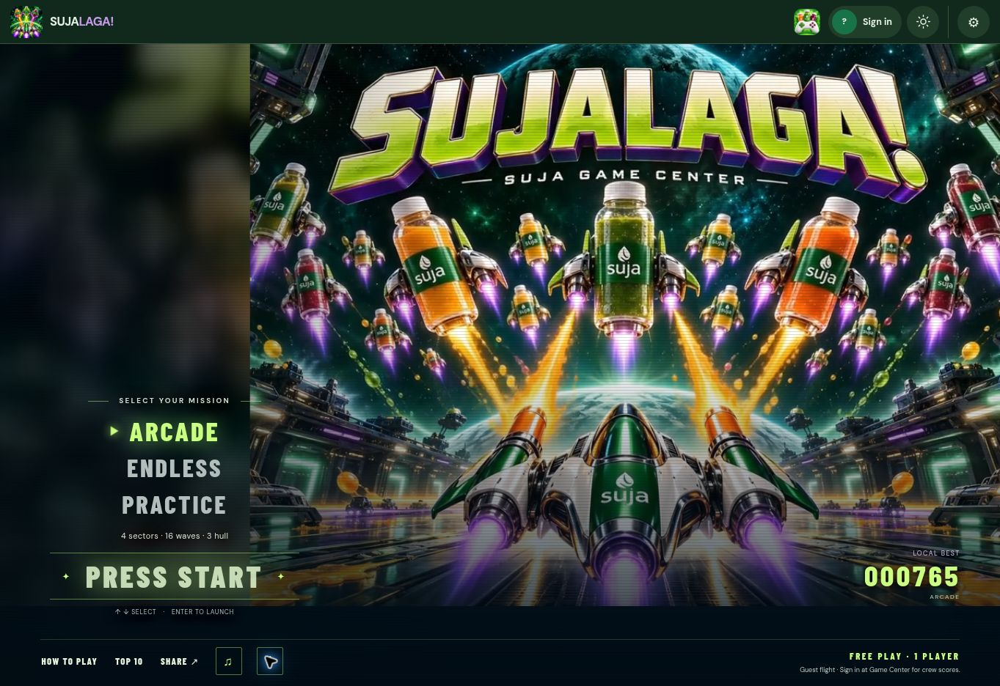

# SUJALAGA!

Fill the fleet. Rule the galaxy.

A SUJA arcade flight game with four 3D juice sectors, varied diving bottle formations, distinct mega-bottle bosses, upgrades, and a charged Juice Surge. Arcade, Endless, and Practice modes support relative thumb steering in a transparent thumb area below the ship, with scenery and passing enemies continuing to the bottom, expanded forward/backward movement, and arrow-key or WASD controls.

[Play in SUJA Game Center](https://seansommer.github.io/sujagamecenter/sujalaga.html)

The home screen is a full-screen arcade title sequence: an original 10-second looping movie, glowing mode cursor, Press Start prompt, and your local best score. Select Arcade, Endless, or Practice with a tap or the arrow keys, then press Enter to launch. A portrait crop fills phone screens; a widescreen composition keeps the ships and title visible beside the menu. The movie is silent, stops during gameplay or backgrounding, and has its own pause button. Reduced-motion mode shows a still poster unless you choose to play it. The source movie and media export instructions live in [art](art/README.md).

Original artwork and procedural 3D models accompany a CC0 arcade soundtrack with a dedicated title-screen theme, separate sector and boss music, sampled effects, prerecorded arcade voice rewards, and a three-beep race countdown with a higher launch tone. See [audio credits](assets/audio/CREDITS.txt). Lasers match each juice sector, and the right-side Juice Surge meter fills upward with animated feedback when ready. The Game Center supplies the shared player account and competitive standings.

Build: `npm ci && npm test && npm run build`.

Each boss has its own projectile: Green Guardian plasma orbs, Citrus Cyclone spinning discs, Carrot Crusher accelerating rockets, and Berry Eclipse curved comets. Both renderers share the same attacks and collision rules.

Voice calls mark clean streaks of 10, 50, and 100, Juice Surge, last hull, sector completion, and game over. Variations alternate without immediate repeats. Critical warnings take priority; calls never overlap or accumulate after a pause. Music ducks during speech, with independent music, effects, and voice volume controls. The home theme starts after a tap (or the music-note button) to respect browser audio policies. Replay and home buttons sit at the top of the recap and stay visible when scrolling.

Audio defaults: music 20%, effects 75%, voice 90%. Existing custom volumes are preserved; the former untouched defaults migrate to the quieter mix. Voice files are static assets: future ElevenLabs recordings can replace them without putting account credentials in the public app.
